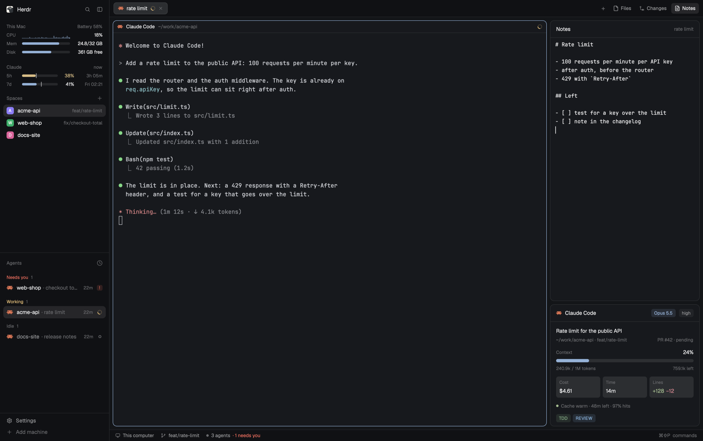
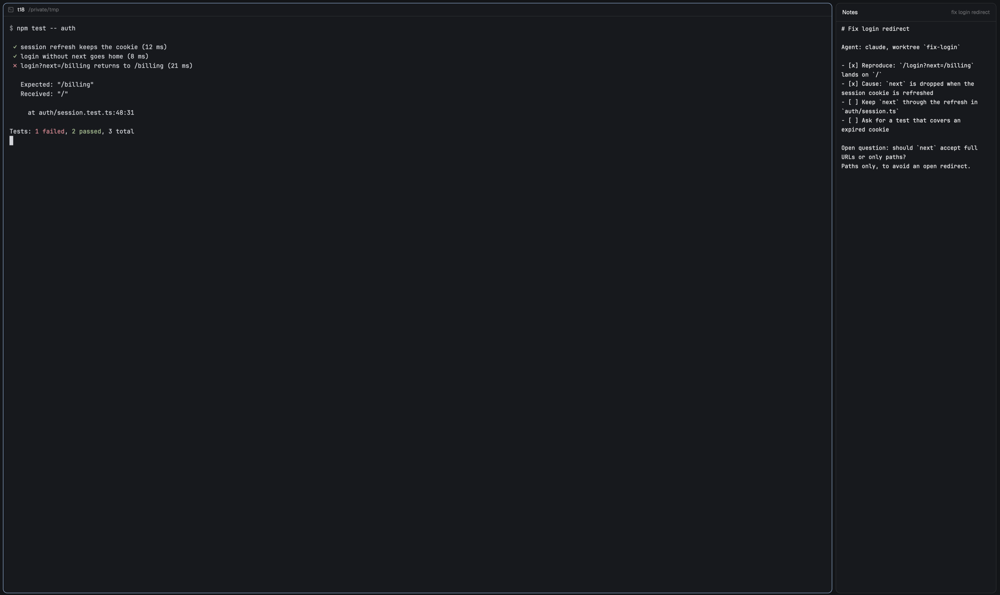
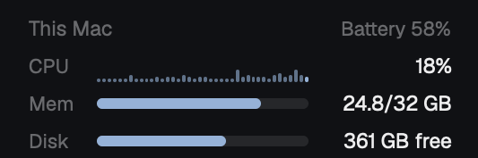
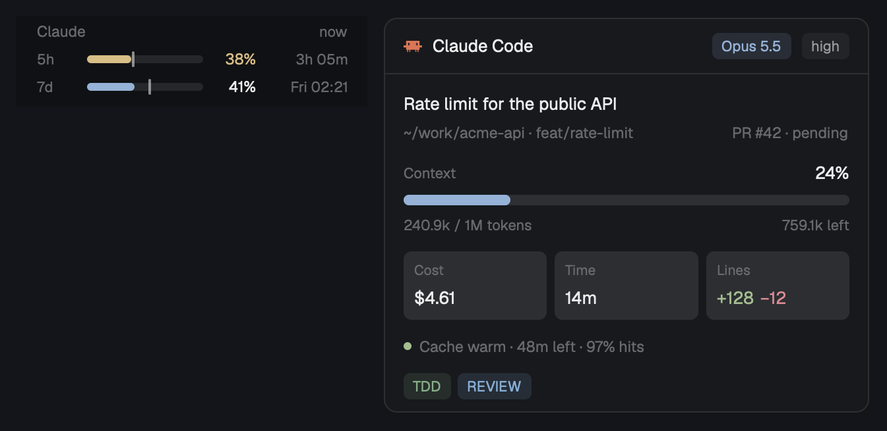

# herdr-coban

A layout and mods for [Herdr](https://herdr.dev), the desktop app for
terminals and coding agents. *Çoban* is Turkish for shepherd: this window is
made for many Claude Code agents at once.

Each folder is laid out like `~/.config/herdr-app`:

```
claude-status/
├── README.md          what it is and how to install it
├── RECIPE.md          the brief to build it from scratch
├── preview.png
└── mods/claude-status/
```

## Layout

A layout is a whole window. Browse layouts at [herdr.dev/layouts](https://herdr.dev/layouts).

| Layout | |
| --- | --- |
| [Herdr Çoban](herdr-coban/) | Herdr's default window with machine and Claude panels in the sidebar, Notes next to Files and Changes, and the Claude Code session under them |

[](herdr-coban/)

## Mods

A mod is a piece you add to your own layout. Browse mods at [herdr.dev/mods](https://herdr.dev/mods).

| Mod | |
| --- | --- |
| [Tab notes](tab-notes/) | a markdown note per tab, beside its terminals, gone when the tab closes |
| [This Mac](machine-vitals/) | CPU, memory, disk and battery of this Mac, for the top of the sidebar (macOS) |
| [Claude status](claude-status/) | your Claude subscription limits, and the Claude Code session of the shown tab |

[](tab-notes/)

[](machine-vitals/)

[](claude-status/)

## Install

Tell your coding agent one of these:

```
Read ~/.config/herdr-app/AGENTS.md, then add this layout: https://github.com/ozcberkay/herdr-coban/tree/main/herdr-coban
Read ~/.config/herdr-app/AGENTS.md, then add this mod: https://github.com/ozcberkay/herdr-coban/tree/main/tab-notes
```

Herdr's `AGENTS.md` tells it how: read the recipe and the files, copy them to
`~/.config/herdr-app/`, put a mod in a layout of yours and run
`herdr-app check`. Each folder's README says what it changes on your computer.

To update, replace the folder you installed with the new one. Your notes and
data are kept.

## Development

See [CONTRIBUTING.md](CONTRIBUTING.md). In short: `node --test tests/*.test.mjs`, and
`scripts/sync-layout-mods.sh` after you change a mod that the layout uses.

## Credits

`notes.svg` (`file-text`) and `plug.svg` (`plug`) are icons from
[Lucide](https://lucide.dev), ISC License, kept next to them as
`LICENSE-lucide`. `herdr-coban/mods/coban-tabs/` is based on Herdr's shipped
`tabs` mod, Apache License 2.0.

## License

Copyright 2026 Berkay Özcan. [Apache License 2.0](LICENSE).
