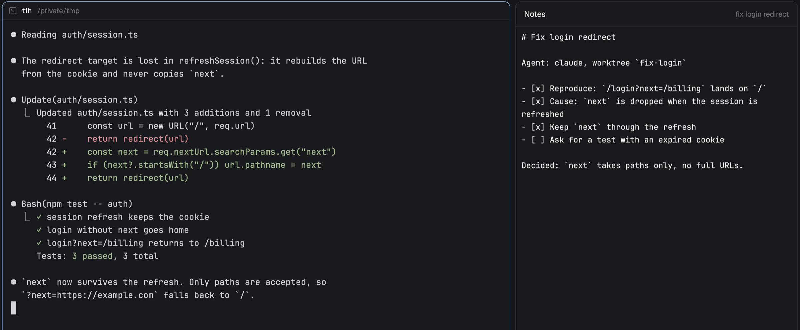

# herdr-coban

Mods for [Herdr](https://herdr.dev), the desktop app for terminals and coding
agents. *Çoban* is Turkish for shepherd.

Each folder is laid out like `~/.config/herdr-app`:

```
tab-notes/
├── RECIPE.md          the brief to build it from scratch
├── preview.png
└── mods/tab-notes/
```

## Mods

A mod is a piece you add to your layout, not a whole window.

| Mod | |
| --- | --- |
| [Tab notes](tab-notes/) | a markdown note per tab, beside its terminals, gone when the tab closes |

[](tab-notes/)

Browse them at [herdr.dev/mods](https://herdr.dev/mods).

## Install

Tell your coding agent:

```
Read ~/.config/herdr-app/AGENTS.md, then add this mod: https://github.com/ozcberkay/herdr-coban/tree/main/tab-notes
```

Herdr's `AGENTS.md` tells it how: read the recipe and the files, copy
`mods/tab-notes/` to `~/.config/herdr-app/mods/`, put it in a layout of yours
and run `herdr-app check`.

To update, replace the mod folder with the new one. Your notes are kept.

## Credits

`notes.svg` is the `file-text` icon from [Lucide](https://lucide.dev)
(ISC License, kept next to it as `LICENSE-lucide`).

## License

Copyright 2026 Berkay Özcan. [Apache License 2.0](LICENSE).
