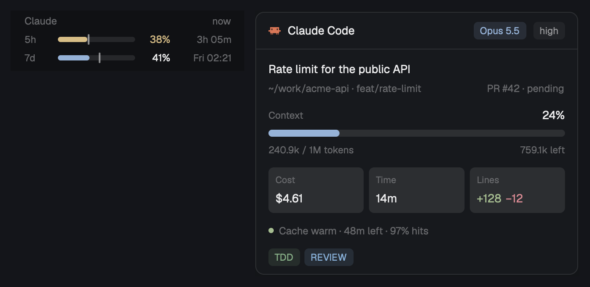

# Claude status

Two panels for [Herdr](https://herdr.dev) from the data Claude Code gives its
own status line:

- **Limits**: your Claude subscription limits, the 5-hour and the weekly
  window, each with a mark for how much of the window has passed. A fill ahead
  of the mark means you use the limit faster than the window passes.
- **Session**: the Claude Code session in the shown tab: model and effort,
  context, cost, time, lines, prompt cache and your status line's badges. It
  shows only while the tab has a Claude Code agent.



## Install

Tell your coding agent:

```
Read ~/.config/herdr-app/AGENTS.md, then add this mod: https://github.com/ozcberkay/herdr-coban/tree/main/claude-status
```

It copies `mods/claude-status/` into `~/.config/herdr-app/mods/`, puts the
panels in a layout of yours and puts `statusline.sh` in front of your Claude
Code status line in `~/.claude/settings.json`. Your earlier command goes in
single quotes, as one argument:

```json
"statusLine": { "type": "command",
  "command": "sh ~/.config/herdr-app/mods/claude-status/statusline.sh --hide-in-herdr '<your earlier command>'" }
```

If the earlier command has a single quote in it, move it into a script file
and give `sh <that file>` as the argument. With no earlier command, leave the
argument out.

The two parts are one mod with different props:

```json
{ "id": "claude-limits", "type": "block", "size": { "px": 80 },
  "content": { "mod": "claude-status", "props": { "part": "limits" } } }
{ "id": "claude-session", "type": "block", "size": { "weight": 3 }, "min": 300,
  "content": { "mod": "claude-status", "props": { "part": "session", "block": "claude-session" } } }
```

The Session part hides its own block when the tab has no Claude Code, and
Herdr remembers that across restarts. A hidden block's mod does not start, so
the panel then stays hidden. In your own layout, start with the block shown
and let a mod that always runs show it once with `layout.show`. The
[Herdr Çoban](../herdr-coban/) layout's tab bar does this.

## What it runs

- `statusline.sh` runs your own status line command, for each Claude Code
  response.
- A click on Limits opens `https://claude.ai/settings/usage` in your browser
  (`open`).

Nothing else reaches the network.

## Where the numbers come from

Claude Code gives its status line the limits and the session after each
response. `statusline.sh` runs your own status line and keeps the last copy
in `~/.config/herdr-app/claude-status/`. With `--hide-in-herdr`, the status
line is empty in each Herdr terminal (the panels show it) and unchanged
outside Herdr. This is so in every layout: if you switch to a layout without
the panels, remove `--hide-in-herdr`. No token and no undocumented endpoint.

## Update and uninstall

To update, copy the new folder over `~/.config/herdr-app/mods/claude-status/`.
Do not delete the old folder first: while it is missing, each Claude Code
response shows an error in the status line. The data folder stays.

To uninstall:

1. In `~/.claude/settings.json`, set the `statusLine` command back to your
   earlier command (the quoted argument), or remove `statusLine`.
2. Remove the panels from your layout.
3. Delete `~/.config/herdr-app/mods/claude-status/` and the data in
   `~/.config/herdr-app/claude-status/`.

[RECIPE.md](RECIPE.md) is the full brief: everything an agent needs to build
the mod again from an empty folder.
