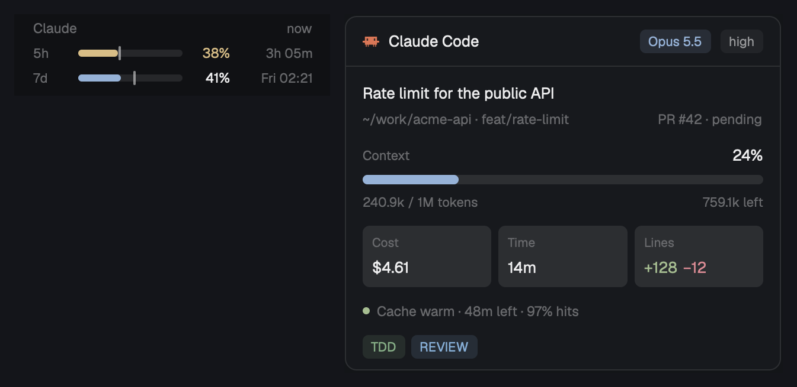

# Claude status

Two panels for Claude Code, from the data that Claude Code gives its own
status line. **Limits** shows how much of your Claude subscription you have
used: the 5-hour window and the weekly window, each with a mark for how much
of the window has passed. **Session** shows the Claude Code session in the
shown tab: model, effort, context, cost, time, lines, prompt cache and the
badges of your status line. It shows only while the shown tab has a Claude
Code agent. This is a piece you add to your layout, not a whole window.



This file is the brief: enough to build the panels from an empty folder. The
files next to it are one build of it.

## What you see

### Limits (`props: { "part": "limits" }`)

- One block, 80px high, on the theme's `chrome` background. Text is 12px.
- A 30px header (8px top padding, 16px side padding): "Claude" on the left
  (11.5px, medium weight, `dim`), the age of the data on the right (11px,
  `dim`): `now` under one minute, else `12m ago`, `2h 05m ago`.
- One 20px row for each window in the data, in this order: `5h`, `7d`, and `$`
  (the spend limit, only behind a Claude apps gateway). Each row, 8px gap:
  - a 30px label (11px, `dim`);
  - a 6px bar with 3px corners on a `border` track. The fill is the used
    percentage. A 2px × 12px mark in `foreground` at 55% opacity shows how much
    of the window has passed. The spend limit has no mark;
  - the used percentage, 32px, right-aligned, 11.5px;
  - the reset, 62px, right-aligned, 11px, `dim`: `4h 23m` under one day, else
    the day and time, `Wed 23:00`. After the reset time: `reset`, with a 0%
    fill in `dim`.
- Colors: `accent` fill and `foreground` text when all is well. `ansi3`
  (yellow) at 70% used or a pace of 85%; `ansi1` (red) at 90% used or a pace
  of 100%. The pace is the used percentage divided by the passed part of the
  window: the percentage at the reset if the use goes on at the same rate.
  There is no pace in the first 5% of a window.
- Under 160px of sidebar width (the rail): `5h` and `7d` (9px, `dim`) over
  their percentages (11px, colored).
- No data file: "No usage yet. Connect the Claude Code status line to
  statusline.sh in this mod's folder." 11px, `dim`.

### Session (`props: { "part": "session", "block": "<its own block id>" }`)

- One panel that fills its block: 10px corners, a 1px `border`, the theme's
  `background`. Text is 13px.
- A 42px header with a bottom border, 14px side padding, 8px gap: the Claude
  Code program icon (14px), "Claude Code" (semibold), then on the right the
  model chip (`Opus 5.5`, `accent` text on `accent` at 13% opacity) and the
  effort chip (`high`, `muted` text on `dim` at 13%). A `fast` chip in `ansi3`
  comes first in fast mode. Chips are 20px high with 5px corners and 11px text.
- The body (12px by 14px padding, 11px gap, scrolls if it is too short):
  - the session name (13px, truncated), then one 11.5px `dim` line: the folder
    (`~/work/acme-api`, at most the last two folder names), the branch or the
    git worktree, and on the right the pull request (`PR #42 · pending`, in
    `ansi2` when approved);
  - **Context**: "Context" (11px, `dim`) and the percentage (13px, semibold)
    over an 8px bar with 4px corners, then `240.9k / 1M tokens` and
    `759.1k left` (11px, `dim`). The fill is `accent` under 60%, `ansi3` from
    60%, `ansi1` from 80%;
  - three tiles side by side, 6px gap, `raised` background, 6px corners:
    Cost (`$4.61`), Time (`14m`), Lines (`+128` in `ansi2`, `−12` in `ansi1`).
    Label 10.5px `dim`, value 13px semibold;
  - the prompt cache: a 6px dot (`ansi2` warm, `ansi3` cold) and
    `Cache warm · 47m left · 97% hits`, or `Cache cold · next request writes
    183.1k` (11.5px, `dim`);
  - badges: each `[NAME]` that your own status line printed (for example a
    plugin's `[TDD]`), in the 256-color it was printed in, then the output
    style (if not `default`), the vim mode and the agent name.
- A Claude Code agent on another machine: "Session details are only kept for
  agents on this computer." Before the first response: "Waiting for the first
  response of this session. …" 12px, `dim`.

## How it behaves

- The data comes from Claude Code itself. Claude Code gives its status line
  command a JSON input after each API response. `statusline.sh` runs your own
  status line command with that input and keeps a copy for the panels.
- Limits reads its file every 15 seconds. The numbers are only as new as the
  last Claude Code response on this computer. Use on claude.ai or the desktop
  app shows after the next Claude Code response.
- Session follows the shown tab every 0.5 seconds and reads the session file
  every 2 seconds while it shows. In a tab with more than one Claude Code
  pane, it shows the focused one, else the one shown last, else the first.
- Session hides its own block (`layout.hide`) while the shown tab has no Claude
  Code pane, and shows it again (`layout.show`) when one comes. The blocks
  around it then take the space.
- Hover: each limit row gives the reset time and the pace; the cost tile says
  that the cost is an estimate at list price; the time tile gives the time
  spent waiting for the API; the cache line gives requests, misses and TTL.
- Clicks: Limits opens https://claude.ai/settings/usage. The Session header
  focuses the Claude Code pane (`pane.focus`).
- Every 60 seconds, Session removes the files of terminals that no longer
  exist on this computer, and the temporary files of stopped status lines.
- There are no keys or animations.

## Built from

- **One mod**, `mods/claude-status/`: `main.js` picks the part from
  `props().part`; `limits.js` and `session.js` are the parts; `data.js` holds
  the pure helpers (no Herdr imports, so Node tests load it); `mod.json`
  (`{ "place": "none", "title": "Claude" }`); `statusline.sh`.
- **`statusline.sh`**, a POSIX `sh` script that wraps the status line:
  - It reads stdin, runs the command in its arguments with the same input
    and prints that output. `--hide-in-herdr` as the first argument prints
    nothing when `HC_TERMINAL_ID` is set (a Herdr terminal), so the status
    line moves into the panels there and stays as it was everywhere else.
  - If the input has `"rate_limits"`, it writes `{"at": <epoch s>, "input":
    <input>}` to `~/.config/herdr-app/claude-status/limits.json`.
  - If `HC_TERMINAL_ID` (the herdr-core address of the terminal) is only
    letters, digits, `_` and `-`, it writes the same to
    `sessions/<terminal>.json` and your status line's output to
    `sessions/<terminal>.line`.
  - Each write goes to `<file>.tmp.<pid>` first and then moves over the file,
    so a reader never sees half a file. A failed write is ignored; the script
    always exits 0.
- **Claude Code setting**, in `~/.claude/settings.json`:

  ```json
  "statusLine": { "type": "command",
    "command": "sh ~/.config/herdr-app/mods/claude-status/statusline.sh --hide-in-herdr <your earlier command>" }
  ```

  Keep the person's earlier status line command as the argument. With no
  earlier command, leave it out.
- **Input fields used**: `rate_limits.{five_hour,seven_day,spend_limit}`
  (`used_percentage`, `resets_at`, `used_usd`, `limit_usd`), `model`,
  `effort.level`, `fast_mode`, `session_name`, `workspace.current_dir`,
  `workspace.git_worktree`, `pr`, `context_window`, `cost`, `prompt_cache`,
  `output_style.name`, `vim.mode`, `agent.name`.
- **Herdr**: `readTextFile`, `fs/promises` (`readdir`, `unlink`), `focused()`
  and `panes()` for the shown tab's Claude Code pane (`app === "claude-code"`
  or `program.key === "claude"`), `terminals()` for the live addresses,
  `run("layout.hide" | "layout.show" | "pane.focus")`, `layout()` for the rail.

## Watch out

- It changes `~/.claude/settings.json`, outside Herdr's folder. Tell the person
  before you install it, and keep their status line command as the argument.
- It writes outside its own folder: `~/.config/herdr-app/claude-status/`. Do
  not keep the data inside `mods/claude-status/`: a write there reloads the mod.
- The data files hold the full status line input: the model, the folder, the
  session id and the costs. They stay on this computer.
- It does not use the undocumented OAuth usage endpoint or the keychain token.
  The limits are older when no Claude Code session runs, but they never break
  with a token refresh or a rate limit.
- A hidden block's mod starts only when the block first shows. If the Session
  block is hidden when the layout loads, its part never starts and never shows
  itself again. Start the layout with the block shown, or have a mod that
  always runs show it once (the herdr-coban layout's tab bar does this).
- The Session block needs room: give it `"min": 300` or more.
- `claude -p` and other runs without a status line do not update the data.
- Claude Code drops a limit window from the input after its reset time. The
  panel shows `reset` until the next response.

## Done when

- `herdr-app check mods/claude-status` passes.
- `node --test tests/claude-status.test.mjs` passes.
- After one Claude Code response, `limits.json` and `sessions/<terminal>.json`
  exist, and Limits shows the same percentages as `/usage` in Claude Code.
- The `5h` mark moves right as the window passes, and the reset counts down.
- Showing a tab without Claude Code hides the Session block; showing one with
  Claude Code brings it back with that session's model and context.
- In a Herdr terminal the Claude Code status line is empty; in another
  terminal it shows the earlier status line.
