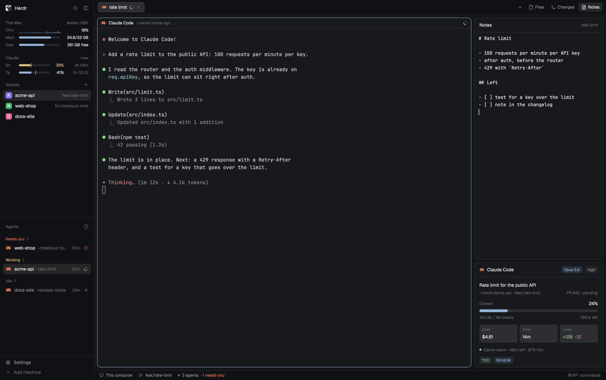

# Herdr Çoban

A [Herdr](https://herdr.dev) layout for many Claude Code agents at once. It
is Herdr's default window with:

- the state of this Mac and your Claude subscription limits at the top of the
  sidebar;
- a **Notes** panel next to Files and Changes, one note per tab;
- under that panel, the Claude Code session of the shown tab: model and
  effort, context, cost, time, lines and prompt cache. It shows only in tabs
  with a Claude Code agent.



## Install

Tell your coding agent:

```
Read ~/.config/herdr-app/AGENTS.md, then add this layout: https://github.com/ozcberkay/herdr-coban/tree/main/herdr-coban
```

It copies `layouts/herdr-coban.json` and the folders in `mods/` into
`~/.config/herdr-app/`, puts `statusline.sh` in front of your Claude Code
status line and switches to the layout. Your own layout stays as it was:
`ctrl-shift-l` switches back. The Claude Code status line stays empty in
Herdr terminals in every layout; see [Claude status](../claude-status/) to
change that.

## What it changes on your computer

- `~/.config/herdr-app/`: one layout and four mods.
- `~/.config/herdr-app/tab-notes/` and `~/.config/herdr-app/claude-status/`:
  the notes and the Claude Code data.
- `~/.claude/settings.json`: the `statusLine` command gets the wrapper in
  front. Your own status line command stays as its quoted argument and still
  shows outside Herdr.
- It runs `iostat`, `vm_stat`, `sysctl`, `df`, `pmset` and `ps` for the
  machine panel, and your own status line command for each Claude Code
  response. A click on a sidebar panel opens Activity Monitor or
  claude.ai in the browser (`open`). Nothing else goes to the network.

## Uninstall

1. In `~/.claude/settings.json`, set the `statusLine` command back to your
   earlier command (the quoted argument), or remove `statusLine`. Do this
   first: without `statusline.sh`, each Claude Code response shows an error.
2. Switch to another layout (`ctrl-shift-l`).
3. Delete `~/.config/herdr-app/layouts/herdr-coban.json`,
   `layouts/herdr-coban.svg` and the four mod folders. Keep
   `~/.config/herdr-app/tab-notes/` if you want your notes.

## The pieces

Each panel is also a mod of its own, for your own layout:

| Mod | |
| --- | --- |
| [Tab notes](../tab-notes/) | a markdown note per tab |
| [This Mac](../machine-vitals/) | CPU, memory, disk and battery |
| [Claude status](../claude-status/) | Claude limits and the Claude Code session |

`mods/coban-tabs/` is Herdr's tab bar with the Notes button. It lives only in
this layout.

[RECIPE.md](RECIPE.md) is the full brief: everything an agent needs to build
the layout again from an empty folder.
