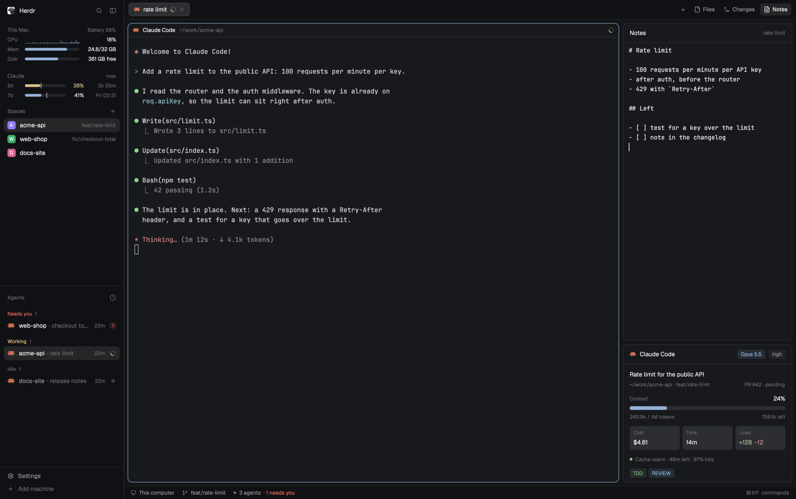

# Herdr Çoban

A window for many Claude Code agents at once, built on Herdr's default
layout. The sidebar starts with the state of this Mac and your Claude
subscription limits, above the spaces and agents lists. The right panel has
Notes next to Files and Changes, and under it a panel for the Claude Code
session of the shown tab.



This file is the brief: enough to build the layout from an empty folder. The
files next to it are one build of it.

## What you see

Left to right, top to bottom:

- **Sidebar**, 268px, theme `chrome`:
  - the brand bar (46px, shipped `workspace-chrome`), a window drag area;
  - **This Mac** (100px, `machine-vitals`): battery, CPU sparkline, memory,
    disk;
  - **Claude** (80px, `claude-status` part `limits`): the 5-hour and 7-day
    limits with a pace mark;
  - Spaces and Agents (shipped `spaces` and `agents`, one weight each);
  - the footer (69px, shipped `workspace-chrome` with `footer: true`).
- **Tab bar**, 42px (`coban-tabs`): the tabs as pills, `+`, then **Files**,
  **Changes** and **Notes**. The open panel's button is `selected`.
- **Work area**, 8px padding and gap:
  - the shown tab's panes as cards: 10px corners, `background`, a 1px `border`,
    `accent` when focused, a 30px header (shipped `pane`), also for a lone pane;
  - the **right panel**, 368px (280px to 900px), hidden until a panel button
    opens it. Top (7 weights): one of Files, Changes or Notes (`tab-notes`).
    Bottom (3 weights, at least 300px): the Claude Code session
    (`claude-status` part `session`), only while the shown tab has a Claude
    Code agent.
- **Status bar**, 28px (shipped `workspace-status`).

## How it behaves

- Files, Changes and Notes behave alike. A click opens that panel; a click on
  the open one closes the panel. Each space keeps its own choice: switching
  spaces brings back what that space had open.
- The Notes panel shows the note of the shown tab (see the `tab-notes` mod).
- The Claude Code session block comes and goes with the shown tab. In a tab
  without Claude Code, the top panel takes the whole height.
- Agent statuses (working, blocked, done, idle) show as in Herdr's default
  layout: in the tab pills, the Agents list and the pane headers.
- Inside Herdr, the Claude Code status line is empty: the panels show its
  information. Other terminals show it as before.
- `ctrl-shift-l` switches back to your earlier layout.

## Built from

- **`layouts/herdr-coban.json`**, a clone of Herdr's `main` with these
  changes:
  - `sidebar` column: `brand`, `machine-vitals` (`{"px": 100}`),
    `claude-limits` (`{"px": 80}`, props `{"part": "limits"}`),
    `sidebar-lists` (`spaces`, `agents`), `sidebar-footer`.
  - `tabs` block: `coban-tabs` in place of `tabs`.
  - `panel` column (`gap: 8`): `panel-body` stack (weight 7) with `files`,
    `changes` and `tab-notes`; then `claude-session` (weight 3, `min: 300`,
    props `{"part": "session", "block": "claude-session"}`).
  - `preview`: `layouts/herdr-coban.svg`.
- **Mods**, in `mods/`:
  - `coban-tabs`: Herdr's shipped `tabs` mod (Apache-2.0) with one more panel
    button, `panelButton("tab-notes", "Notes", "mods/tab-notes/notes.svg")`,
    and `"tab-notes"` added to the panels it remembers per space. Its `init`
    shows the `claude-session` block once, so that block's mod starts.
  - `tab-notes`, `machine-vitals`, `claude-status`: copies of the mods of the
    same name in this repository. Each has its own `RECIPE.md` there.
- **Claude Code setting** for `claude-status`, in `~/.claude/settings.json`:

  ```json
  "statusLine": { "type": "command",
    "command": "sh ~/.config/herdr-app/mods/claude-status/statusline.sh --hide-in-herdr <your earlier command>" }
  ```

## Watch out

- The mods run programs (`machine-vitals`: `iostat`, `vm_stat`, `sysctl`, `df`,
  `pmset`, `ps`), write outside their folders (`~/.config/herdr-app/tab-notes/`,
  `~/.config/herdr-app/claude-status/`) and change `~/.claude/settings.json`.
  Tell the person before you install the layout.
- `machine-vitals` works on macOS only.
- A panel button needs a child of `panel-body` with the same id. The Notes
  button opens `tab-notes`; a renamed block leaves the button without a panel.
- A hidden block's mod starts only when the block first shows. That is why
  `coban-tabs` shows `claude-session` once at start; without it, the session
  panel can stay hidden after a restart.
- The status line wrapper keeps the person's own status line as its argument.
  Do not replace their command.
- The layout keeps Herdr's own look: no theme, fonts or colors of its own, so
  your settings decide them.

## Done when

- `herdr-app check` passes for each folder in `mods/`.
- `herdr-app do layout.switch --name herdr-coban` shows the window above.
- The Notes button opens the shown tab's note, and Files and Changes switch
  away and back without closing the panel.
- Switching spaces brings back the panel each space had open.
- A tab with Claude Code shows the session panel under the top panel after its
  first response; a tab without one shows no session panel.
- The sidebar shows CPU, memory, disk, the battery and the two Claude limits.
