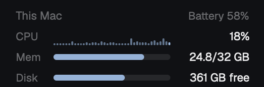

# This Mac

A small panel for [Herdr](https://herdr.dev) at the top of the sidebar: CPU
over the last two minutes, memory as Activity Monitor counts it, free disk
and the battery. macOS only.



## Install

Tell your coding agent:

```
Read ~/.config/herdr-app/AGENTS.md, then add this mod: https://github.com/ozcberkay/herdr-coban/tree/main/machine-vitals
```

It copies `mods/machine-vitals/` into `~/.config/herdr-app/mods/` and puts the
panel in a layout of yours, for example above `spaces` in the sidebar:

```json
{ "id": "machine-vitals", "type": "block", "size": { "px": 100 }, "content": { "mod": "machine-vitals" } }
```

## What it does

- A sample every 3 seconds while Herdr is in front, every 30 seconds behind.
  A sample costs about 0.06 seconds of CPU.
- Memory is colored by the memory pressure of macOS.
- A plug icon shows next to the battery on AC power.
- Hover on CPU for the busiest processes. Click to open Activity Monitor.
- It runs `iostat`, `vm_stat`, `sysctl`, `df` and `pmset`, and `ps` on hover.
  No network, no files.

To update, replace `~/.config/herdr-app/mods/machine-vitals/` with the new
folder.

[RECIPE.md](RECIPE.md) is the full brief: everything an agent needs to build
the mod again from an empty folder.
