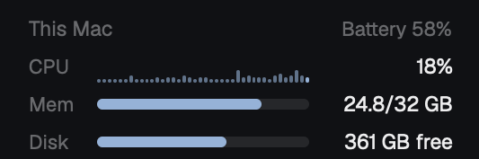

# This Mac

A small panel for the top of the sidebar that shows the state of this Mac
while agents run: CPU over the last two minutes, memory as Activity Monitor
counts it, free disk and the battery. This is a piece you add to your layout,
not a whole window.

This file is the brief: enough to build the panel from an empty folder. The
files next to it are one build of it.

## What you see

- One block, 100px high, on the theme's `chrome` background. Text is 12px.
- A 30px header (8px top padding, 16px side padding): "This Mac" on the left
  (11.5px, medium weight, theme `dim`), the battery on the right (11px, `dim`):
  `Battery 78%`. On AC power, a 12px plug icon (Lucide `plug`) comes before
  the text. Without AC power at 15% or less, the text is `ansi1` (red). A Mac
  without a battery shows no battery text.
- Three rows, each 20px high, 16px side padding, 8px gap. Each row has a 30px
  label (11px, `dim`), a visual that fills the width, and a 72px value on the
  right (11.5px, `foreground`, right-aligned, truncated):
  - **CPU:** a sparkline of 40 bars, 18px high, 1px gap. Each bar is the CPU
    use of one sample. Empty slots are 1px bars in `border`. The value is the
    last sample, `27%`.
  - **Mem:** a 6px bar with 3px corners on a `border` track. The fill is the
    used memory of the total. The value is `25.7/32 GB`.
  - **Disk:** the same bar for the used part of `/`. The value is `361 GB free`.
- Colors: `accent` when all is well. CPU at 85% or more and disk at 90% or
  more are `ansi3` (yellow), and 95% or more is `ansi1`. Memory follows the
  memory pressure of macOS: normal is `accent`, warning is `ansi3`, critical
  is `ansi1`. A value in a warning color also takes that color.
- Under 160px of sidebar width (the rail), the block shows only two stacked
  values: `CPU` and `MEM` (9px, `dim`) over their percentages (11px, colored).
- `…` shows in place of a value before the first sample.

## How it behaves

- A sample every 3 seconds while the Herdr window is in front, every 30
  seconds while it is behind. One sample takes about 1 second of wall time
  and about 0.06 seconds of CPU.
- The sparkline keeps the last 40 samples (2 minutes in front). It starts
  empty each time the panel starts.
- Hover on CPU: a tooltip with the three processes that used the most CPU
  lately. The panel asks `ps` for them only while the pointer is on the row.
- Hover on Mem: the memory pressure name and the swap use. Hover on the
  battery: its state (charging, discharging, charged) and AC power.
- A click anywhere on the panel opens Activity Monitor.
- There are no agent statuses, keys or animations.

## Built from

- **One mod**, `mods/machine-vitals/`: `main.js` (the panel), `stats.js` (the
  commands and their parsers, with no Herdr imports, so Node tests load it),
  `mod.json` (`{ "place": "none", "title": "This Mac" }`), `plug.svg` (Lucide
  `plug`) and `LICENSE-lucide`, the icon's ISC license.
- **One program per sample**: `exec("sh", ["-c", SCRIPT])`. The script runs
  these, with an `@name` line before each part:
  - `iostat -n 0 -c 2 -w 1`. Use the last row: the first one counts from
    boot. CPU is `100 - id`.
  - `vm_stat`. Used memory is Activity Monitor's "Memory Used":
    `(Anonymous pages - Pages purgeable + Pages wired down + Pages occupied by
    compressor) × page size`.
  - `sysctl -n hw.memsize kern.memorystatus_vm_pressure_level vm.swapusage`.
    Pressure level 1 is normal, 2 is warning, 4 is critical.
  - `df -k /`: total and available of the root volume.
  - `pmset -g batt`: percentage, state and "AC Power".
- **On hover only**: `ps -Aceo pcpu=,comm= -r | head -n 6`, without `ps`,
  `head` and `sh`.
- `cx.timer.every(3000)` starts a sample if the last one is older than the
  interval for the window state (`window().active`) and no sample runs now.
- `layout()` finds the `sidebar` node. A width under 160px means the rail.
- Fractional widths are percentage strings: `.w("46%")`.
- `exec("open", ["-a", "Activity Monitor"])` on click.

## Watch out

- macOS only. The commands and the parse do not work on Linux or Windows.
- It shows this computer, also when the shown space is on another machine.
- It runs programs (`exec`): tell the person before you install it.
- Do not use `top` for the CPU. `top -l 2` reads every process and costs about
  1.5 seconds of CPU per sample, which is half a core at a 3 second interval.
  `iostat` reads the CPU counters only.
- `top`'s "used" memory counts the file cache, so it is almost always full. Use
  the `vm_stat` sum above.
- Do not redraw on a timer for the sparkline. Redraw only when a sample
  arrives: every redraw of a mod redraws the whole window.

## Done when

- `herdr-app check mods/machine-vitals` passes.
- `node --test tests/machine-vitals.test.mjs` passes.
- The CPU value follows Activity Monitor's CPU total within about 10 points.
- The memory value is within 1 GB of Activity Monitor's "Memory Used".
- The sparkline grows one bar every 3 seconds while the window is in front.
- With AC power, the plug icon shows before the battery text.
- A click opens Activity Monitor.
- Under 160px of sidebar width, the panel shows only the CPU and MEM values.
